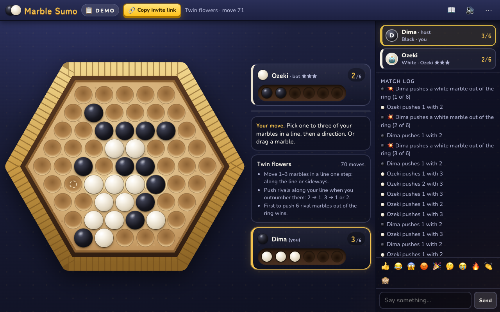

# Marble Sumo

A two-player duel of black and white marbles on a hexagonal ring, in the browser. Move one, two or three marbles in
a line, outnumber your rival to push their marbles back, and shove six of them over the edge to win. It plays by
the classic marble-pushing rules, with its own name, artwork and texts.

## Features

- **The full rules**: in-line and sideways moves of 1–3 marbles, pushes (2 against 1, 3 against 1 or 2), blocked
  pushes, marbles pushed out over the edge, six out wins. Optional move limit and resignation.
- **Three openings**: Classic (a calm first game), Twin flowers and Wide flowers (contact from the first move), or a
  random one.
- **Three bots**: the Rookie, the Ozeki and the Yokozuna, from gentle to a time-budgeted alpha-beta search.
- **Tap or drag**: pick a line of marbles and tap an arrow (red ones push), or just drag a marble where it should go.
- **Looks and feel**: a clay ring with a straw-rope border, glossy marbles that slide, pushes that shove, marbles
  that roll off the edge into your tray; synthesised sounds; phone, tablet and desktop layouts; a rule book with
  diagrams in the lobby and at the table. The board turns so your marbles start at the bottom.

## Play

`uv run bg serve`, create a room, vote for Marble Sumo. Bot matches: `uv run bg sumo eval --help`.
