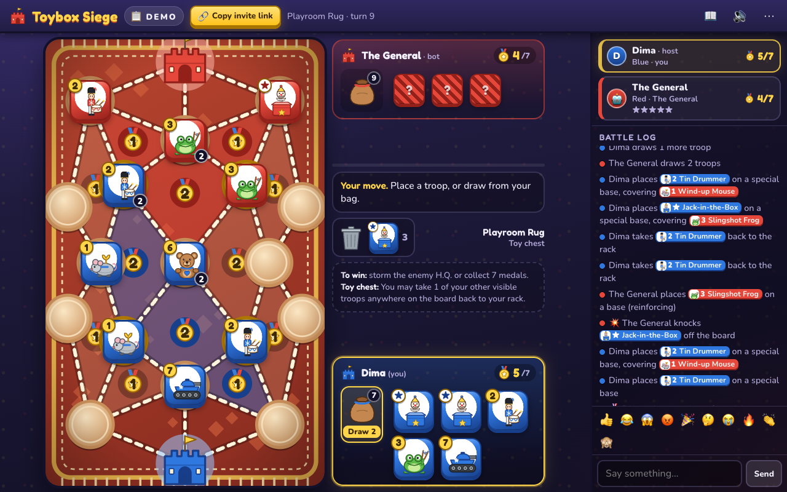

# Toy Battle

A two-player duel of toy armies, in the browser. Place your toys on the bases of the playroom floor, cover weaker
enemy toys, take regions for medals, and storm the enemy H.Q. It follows the rules of the published game TOY
BATTLE (rulebook and player aid), with its own toys, artwork and eight terrains that follow the published maps.

## Features

- **The full rules**: 24 troops per army in 8 kinds, 4 put back unseen, 3 or 4 to start; draw 2 or place 1;
  connection to your H.Q., covering with stronger troops, the joker; all troop effects (draw, extra placement,
  knock-off, airdrop, magnet) and the special bases of every terrain; medals for regions; win by H.Q. or medals,
  and the "stuck" ending.
- **Eight terrains**, picked at the top of the lobby (or at random): Castle Field (best for a first game), Tropical
  Pool, City of Clouds, Volcanic Jungle, Cursed Cemetery, Caribbean Sea, Station Metal-X and Battlefield. The
  special bases can be switched off for a calmer first game.
- **Your own side of the table**: the board turns so your H.Q. is always at the bottom; your rack is yours alone.
- **The General**: one strong bot that searches whole turns ahead over several guesses of what it can't see. It
  never peeks at your rack or the reserves.
- **Looks and feel**: original SVG toys and boards, troops that fly and stomp, knock-offs, medal flights, a
  collapsing fort; synthesised sounds; phone, tablet and desktop layouts; a rule book in the lobby and at the table.
- **Fair play**: the server holds the game and checks every move; hidden troops never leave it.

## Play

`uv run bg serve`, create a room, vote for Toy Battle. Bot matches: `uv run bg toybattle eval --help`.
